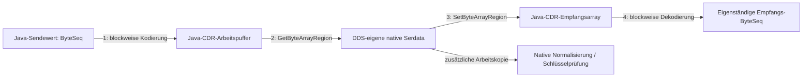

# Schritt 3: CDR-/JNI-Kopien und Speicherlebensdauer

Stand: 18. November 2026. Schritt 2 wurde vor dieser Arbeit als `24880cb`
committed. Die hier beschriebenen Änderungen bauen darauf auf.

## Was mit „vier Kopien“ gemeint war

Die bisherige Kennzahl waren vier ungefähr nutzdatengroße **Java-Allokationen**
pro großem Write+Take. Sie war keine Zählung aller Kopiervorgänge:

1. CDR-Arbeitspuffer auf dem Java-Heap;
2. `toByteArray()`-Ausgabearray;
3. Java-CDR-Empfangsarray;
4. die eigenständig besessene dekodierte Byte-Sequenz.

Dazu kamen native Speicherbereiche, deren Kopien und deren Initialisierung.
Insbesondere `GetByteArrayElements` lieferte auf der getesteten JVM beim Senden
und Empfangen tatsächlich Kopien. Der Empfangspfad kopierte dabei zunächst auch
den Inhalt eines frisch angelegten, noch leeren Java-Arrays in einen nativen
Zwischenpuffer und anschließend das befüllte Ergebnis zurück.

Beim einfachen unkeyed Byte-Sequenz-Schema ergab das vorher acht vollständige
**Nutzdatentransfers** einschließlich der nativen Normalisierungs-Arbeitskopie,
plus den zusätzlichen Transfer des noch leeren Empfangsarrays. Diese Zählung
enthält weder Betriebssystem-/Allocator-Initialisierung noch Anlegen der
Anwendungsdaten vor `write`, Header, Wachstumskopien komplexer Nachrichten oder
Netzwerk-/Kernelkopien. Sie gilt für den normalen Write ohne zusätzliche
explizite Instanzhandle-Prüfung.

## Umgesetzte Änderungen

### Schreiben

Der interne Schreibpfad hält den exklusiv geliehenen CDR-Puffer bis zum Abschluss
des synchronen nativen Aufrufs. `CdrWriter.writeTo` übergibt dessen gültige Länge,
nicht seine Kapazität. Die native Funktion füllt mit `GetByteArrayRegion` direkt
den endgültigen DDS-eigenen Serdata-Speicher. Erst danach darf der Java-Puffer
freigegeben und wiederverwendet werden.

Damit entfallen das zusätzliche Java-Ausgabearray sowie der JNI-Zwischenpuffer
und dessen anschließendes Umkopieren in Serdata. Das öffentliche
`CdrWriter.toByteArray()` erzeugt weiterhin eine unabhängige Kopie. Auch
Write-with-timestamp und WriteDispose verwenden den neuen internen Pfad.
Registrierung, Lookup und die Prüfung eines expliziten Instanzhandles behalten
vorerst ihren bestehenden Snapshot-Pfad; sie gehören nicht zum normalen
Benchmark-Write.

### Empfangen

Der native Collector hält die Serdata-Referenz. Eine zusätzliche kurzlebige
`to_ser_ref`-Referenz schützt den serialisierten Speicher während eines direkten
`SetByteArrayRegion` ins Java-Empfangsarray. Sie wird anschließend auch auf
JNI-Fehlerpfaden freigegeben. Der bisherige `GetByteArrayElements`-Zwischenpuffer
und dessen Rückkopie entfallen.

Die Java-Dekodierung erzeugt weiterhin eigenständige Empfangswerte. Diese hängen
nach Rückkehr nicht von der nativen Referenz oder dem nächsten Take ab.

### Langfristig gehaltene Daten

Das OMG-Sample speicherte bisher neben dem dekodierten Objekt das ursprüngliche
CDR-Array im `WireSample`. Die Sample-Methoden benötigen daraus nur Metadaten.
`Samples.Data` übernimmt nun eine Metadatenkopie ohne CDR-Payload. So wird nicht
zusätzlich eine weitere vollständige serialisierte Nachricht so lange gehalten
wie das Anwendungs-Sample. Das vereinfacht auch dessen Java-Serialisierung.

### CDR-Reservierung

Für die große einzelne Byte-Sequenz reserviert der Blocktransfer aus Schritt 2
bereits den kompletten bekannten Bedarf, bevor die Bytes geschrieben werden.
Dabei wird nur der kurze bisherige Header umkopiert. Es gibt in diesem Fall
keine Wachstumskopie einer bereits gefüllten 1-GB-Nachricht.

Für komplexe Nachrichten mit mehreren variablen Feldern bleibt amortisiertes
Pufferwachstum erhalten. Ein zusätzlicher vollständiger Größen-/Serialisierungs-
Durchlauf wurde nicht eingeführt. Der kleine globale Pool bleibt auf Puffer bis
1 MiB begrenzt; es wurde kein unkontrollierter GB-Pool hinzugefügt.

## Verbleibender Kopierpfad

Für die betrachtete Byte-Sequenz sieht der Hauptpfad nun so aus:

Das sind **vier Hauptpfadtransfers plus eine Normalisierungs-Arbeitskopie**,
also fünf Nutzdatentransfers statt vorher acht. Bei großen Nachrichten werden
jetzt drei statt vier nutzdatengroße Java-Arrays pro Write+Take allokiert; bei
kleinen Nachrichten wird der CDR-Arbeitspuffer wiederverwendet.

Das ist keine Zero-Copy-Implementierung und auch keine Behauptung, fünf Transfers
seien grundsätzlich unvermeidbar. Es beschreibt den aktuellen Entwurf mit
Java-Heap-CDR und eigenständigen Anwendungsobjekten.

## Kontrollierte Aufteilung des Nutzens

Zusätzlich zur vollständigen Matrix wurden bei 200,01 MB drei Kombinationen mit
je drei frischen Prozessen und je drei Aufwärm-/fünf Messnachrichten verglichen.
Der alte Java-Pfad stammt aus dem eingefrorenen Runtime-JAR der Schritt-2-Messung;
dessen native Bibliothek wurde aus dem Schritt-2-Quellstand separat gebaut.
Alle Varianten verwenden dieselbe native DDS-Core-Binärdatei.

| Variante | Median Write+Take | Java-Allokation je Nachricht |
|---|---:|---:|
| A: Schritt 2, bisherige JNI-Bibliothek | 110,67 ms | 800,04 MB |
| B: Schritt-2-Java, nur neue JNI-Übertragung | 70,45 ms | 800,04 MB |
| C: vollständiger Schritt 3 | 61,07 ms | 600,03 MB |

Die JNI-Änderung allein reduziert die Zeit hier um etwa 36 %. Der vollständige
Schritt 3 reduziert sie gegenüber A um etwa 45 % und spart ein vollständiges
Java-Ausgabearray. C kombiniert die direkte Java-Pufferübergabe und die kürzere
Metadatenhaltung; deren Einzelbeiträge werden mit diesem Versuch nicht getrennt.

## Frischer Vergleich mit C#

Fünf unabhängige Prozesse je Größe und Sprache, wechselnde Reihenfolge,
identisches IDL-Schema, identische native Core-Binärdatei,
Reliable/KeepAll/XCDR1 und lokale Owned-Data-Zustellung. Vollständige Inhalts- und
Counterprüfung außerhalb der Zeitmessung. Java: Temurin 19.0.2, G1, 8 GiB Heap;
C#: .NET 9.0.9. Host: M1 Max, 32 GiB RAM. Median der Prozessmittelwerte:

| Nutzdaten | Java nach Schritt 3 | C# | Java/C# |
|---|---:|---:|---:|
| 41,0 KiB | 0,0172 ms | 0,00827 ms | 2,08× |
| 164,0 KiB | 0,0427 ms | 0,0361 ms | 1,18× |
| 200,01 MB | 66,79 ms | 35,82 ms | 1,86× |
| 1 GB | 373,25 ms | 178,67 ms | 2,09× |

Die Aufwärm-/Messanzahlen entsprechen den vorigen Serien: 3.000/10.000,
1.000/3.000, 3/5 und 1/3. Ein vorgeschalteter 12-GiB-Vorlauf ist ein separater
Diagnosetest und nicht Teil der obigen Werte. Bei 1 GB bestanden alle fünf
Java-Prozesse mit 8 GiB Heap sämtliche Inhaltsprüfungen. Hintergrundlast und
thermischer Zustand sind nicht kontrolliert; insbesondere die großen kurzen
Aufwärmreihen garantieren keinen JVM-Steady-State.

Das vorgeschlagene 1,5×-Zeitziel ist bei 164 KiB erreicht. Bei den anderen drei
Größen besteht weiterhin ein Abstand. Die Messung gilt für lokale Zustellung,
nicht für Netzwerkdurchsatz oder Netzwerk-Roundtrip-Latenz.

| Nutzdaten | Java-Allokation je Write+Take | Java Prozess-RSS | C# Prozess-RSS |
|---|---:|---:|---:|
| 41 KiB | 0,085 MB | 402,1 MB | 63,3 MB |
| 164 KiB | 0,338 MB | 386,5 MB | 59,2 MB |
| 200,01 MB | 600,03 MB | 1.214,5 MB | 1.490,5 MB |
| 1 GB | 3.000,00 MB | 6.034,7 MB | 6.057,3 MB |

Dezimale MB. Java-Allokationen sind kumulierte Thread-Allokationen innerhalb des
Write+Take, keine gleichzeitig lebenden Bytes. RSS ist der Median der
betriebssystemseitigen Prozess-Spitzenwerte einschließlich Vorbereitung und
Prüfung; er umfasst auch native Puffer und Laufzeitumgebungen. Es wurde kein
Heap-Mindestbedarf gemessen.

## Native Teilphasen: Was jetzt tatsächlich kostet

Ein separater instrumentierter Prozess mit drei Aufwärm- und fünf Messnachrichten
zu je 200,01 MB verwendete eine temporäre, sonst gleiche JNI-Bibliothek.
Mittelwerte der fünf Messnachrichten; diese Diagnose ersetzt keine obige
uninstrumentierte Vergleichsserie:

| Native Teilphase | Zeit je Nachricht |
|---|---:|
| DDS-Datenpuffer anlegen/initialisieren | 11,86 ms |
| Java-CDR direkt in DDS-Datenpuffer kopieren | 4,43 ms |
| Normalisierungs-Arbeitspuffer anlegen und befüllen | 16,59 ms |
| Normalisierungs-/Validierungsalgorithmus dieses Schemas | 0,0004 ms |
| Schlüsselverarbeitung / Hash | 0,0026 ms |
| Normalisierungs-Arbeitspuffer freigeben | 1,12 ms |
| Java-CDR-Empfangsarray anlegen | 1,82 ms |
| Native CDR-Daten ins Java-Array kopieren | 4,40 ms |

Die native Eingangsallokation plus das Befüllen kosten hier zusammen 16,29 ms.
Die weitere Normalisierungs-Arbeitskopie mit Freigabe kostet etwa 17,72 ms. Das
zeigt einen konkreten verbleibenden Hebel: In diesem einfachen unkeyed
Byte-Schema ist die zusätzliche Speicherbewegung teuer, nicht die eigentliche
Längen-/Formatprüfung. Diese Aussage gilt nicht pauschal für komplexe Typen.

Ein weiterer isolierter Versuch ersetzte nur in der temporären Diagnose die
vollständige Nullinitialisierung durch nicht initialisierte Allokation mit
initialisiertem Header und Padding. Die Allokation sank auf 0,009 ms, der nächste
Transfer stieg auf 17,95 ms. Die Summe wurde nicht besser; Erstbelegungskosten
verschoben sich. Es gibt damit keinen nachgewiesenen Gewinn durch einen bloßen
calloc/malloc-Austausch, und diese Variante wurde nicht in den Wrapper übernommen.

Eine zusätzliche JFR-Diagnose lokalisierte native Stichproben in `Native.writeCdr`
und `Native.select`. Bei 200 MB lagen die gemessenen GC-Pausen in den markierten
Write-/Take-Intervallen bei etwa 3,0 % bzw. 5,4 %, deutlich unter den früheren
Diagnosen des Referenzlisten-Entwurfs. Java- und Native-Stichproben haben
unterschiedliche Abtastperioden und geringe Anzahlen; sie werden nicht zu exakten
CPU-Prozentanteilen oder C-internen Kopieranteilen verrechnet. Die Tabelle oben
stammt aus direkten nativen Zeitmessungen.

## Was weitere Kopien einsparen könnte

1. **Normalisierung ohne pauschale Arbeitskopie:** Einen ausreichend eng
   begründeten Pfad untersuchen, der Validierung und Schlüsselverarbeitung
   erhält. Die heutige Kopie schützt den ursprünglichen CDR-Inhalt, weil native
   Normalisierung etwa Try-construct-Werte verändern kann. Java benötigt die
   ursprüngliche Darstellung für korrektes Recovery einschließlich expliziter
   Defaultwerte. Einfach die Prüfung abzuschalten oder beliebige Daten
   blind in-place zu normalisieren würde diese Semantik ändern.
2. **CDR direkt in übertragbaren nativen Speicher schreiben:** Ein intern
   geliehener nativer CDR-Puffer könnte Java-CDR-Zwischenspeicher und eine
   Übergabekopie ersetzen. Dafür muss Pufferwachstum sowie Besitzübergabe bei
   Erfolg und Fehlern ausdrücklich verwaltet werden.
3. **Internes natives Lese-Loan während synchroner Dekodierung:** Direkt aus
   gehaltenem nativem CDR in das eigenständige Empfangsobjekt dekodieren könnte
   das Java-CDR-Empfangsarray sparen. Die native Referenz muss auch bei
   Decoderfehlern korrekt enden; geliehene Reader/Buffer dürfen nicht nach
   Freigabe verwendet werden. Das ist eine zusätzliche Lebensdauer-Architektur,
   keine reine Ersetzung einer memcpy-Zeile.

Diese Optionen sind weitere Untersuchungen, keine bereits implementierten
Optimierungen. Sie benötigen kein öffentliches Zero-Copy-Versprechen; ein
öffentliches Loan-API wäre nochmals eine eigene Betriebsart mit anderen
Lebensdauerregeln. Nach Rückkehr aus `write(T)` darf die Anwendung ihren Sendewert verändern,
ohne die bereits publizierte Nachricht zu verändern. Empfangene Owned-Daten
bleiben nach weiteren Takes gültig.

## Validierung und Artefakte

Die vollständige CTest-Suite bestand mit **109/109 Tests**, einschließlich
C-Interoperabilität, Recovery, PSMX-Typunterstützung, Paket-/Consumer-Tests,
Beispielen und Lebensdauer-Stresstest. Der neue `CdrTransferTest` prüft gültige
Längen statt Pufferkapazität, Fehler-/Nullparameter, mutierte Eingabepuffer,
geschlossene und wiederverwendete CDR-Puffer, unabhängige Empfangsarrays und die
Metadatenkopie ohne Nutzdaten.

Lokale Rohdaten, die A/B/C-Reihe, native Teilphasen, temporäre Diagnosequellen,
JFR-Aufzeichnungen, Startbefehle, Binärhashes, eingefrorene Messbibliotheken und
Diagramme liegen in `benchmarks/copies-step3-20261118` und werden nicht versioniert.
Produktive Änderungen und Tests liegen im regulären Quellbaum. Die 200-MB-
Teilphasen sind ein einzelner Diagnoseprozess; belastbare universelle
Plattformvorhersagen werden daraus nicht abgeleitet.
